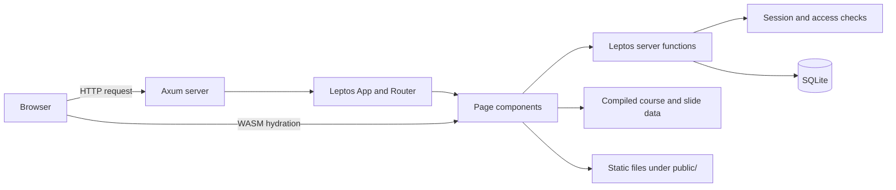

# Architecture

This document describes the current implementation in this repository.

## Runtime overview

The application uses Leptos for server-side rendering (SSR) and browser-side hydration, with Axum as the HTTP server. The same library crate is compiled in two modes:

- `ssr` builds the native server.
- `hydrate` builds the WebAssembly code that attaches browser interactions to the server-rendered HTML.

`src/lib.rs` exports the shared modules and the browser `hydrate()` entry point. `src/main.rs` initializes SQLite, configures upload storage, creates the Axum routes, and serves the Leptos application. Slide media is exposed from `public/slides/` at `/slides-media/` and `/slides_media/`.

## Routing and page composition

`src/app.rs` defines the shared shell: the site header, navigation, global search form, user navigation, and Leptos routes. It creates a shared `Resource<Option<User>>` for the current login state and makes it available to child components.

Active page routes are:

| Route | Component | Purpose |
| --- | --- | --- |
| `/` | `HomePage` | Home page and recent posts |
| `/search?q=...` | `SearchPage` | Global search results |
| `/teacher` | `TeacherPage` | Teacher information |
| `/classes` | `ClassesPage` | Course catalog; an optional `learner` query carries a selected learner into course pages |
| `/classes/:id` | `ClassDetailPage` | Course introduction, videos, learning map, discussion, and lesson decks |
| `/profile` | `ProfilePage` | Learner progress, parent-child linking, and course assignment |
| `/blog` and `/blog/:slug` | `BlogPage`, `PostDetailPage` | Blog listing and detail |
| `/news` and `/news/:slug` | `NewsPage`, `PostDetailPage` | News listing and detail |
| `/login` | `LoginPage` | Sign in and registration |
| `/admin` | `AdminPage` | Admin page |

Opening a deck from a course uses `/classes/:id?deck=:deck_id`; parent links also include `learner=:profile_id`. `ClassDetailPage` reads these query parameters and renders `SlideDeckViewer` in place of the course overview. A slide hash such as `#slide-10` targets a slide inside that viewer, and the query URL keeps the selected deck on refresh.

The standalone `/slides` and `/slides/:id` route declarations are currently commented out in `src/app.rs`. Their older page components remain commented in `src/classes/slides/mod.rs`.

## Course and slide content

Course records are compile-time Rust data in `src/classes/mod.rs`, collected in `ALL_COURSES`. A course points to its deck IDs and weekly outline. Middle East course weeks are in `src/classes/middle_east/mod.rs`; the toilet course has its own `TOILET_WEEKS` entry.

Slide content is also compiled into the application:

- Shared `Slide`, `MediaItem`, and `SlideDeck` types live in `src/classes/slides/model.rs`.
- Deck modules live under `src/classes/middle_east/` and `src/classes/toilet/`.
- `src/classes/slides/mod.rs` collects the published decks in `ALL_DECKS` and provides `SlideDeckViewer`.
- Images and video files live under `public/slides/<deck-id>/media/` and are served as static media.

`CourseVideoLibrary` and `CourseMindMap` derive their content from the course's deck IDs and weekly outline. The Rust course and slide data are not loaded from SQLite.

The old `src/slides/` directory remains in the repository, but it is not exported by `src/lib.rs`; the active slide implementation is under `src/classes/slides/`.

## Server functions and persistence

`src/db.rs` opens SQLite using `DATABASE_URL` when set, or `sqlite:bookreader.db?mode=rwc` by default. `db::init()` creates the tables at server startup and seeds example book chapters and posts when those tables are empty.

The database stores:

- `users` and `sessions` for accounts and login sessions.
- `books` and `chapters` for book records and chapter text.
- `files` for uploaded-file metadata; uploaded bytes are stored in the `storage/` directory (or `UPLOAD_DIR`).
- `posts` for seeded post rows.
- `subscriptions`, `learner_profiles`, `account_link_tokens`, `course_purchases`, `learner_courses`, and `course_progress` for learner dashboards and course access; `course_access` remains as a legacy migration source.
- `classes` and `class_comments` for class-related records and comments.

Authentication is implemented in `src/auth.rs`. Passwords are stored as bcrypt hashes. The server associates an HttpOnly `session` cookie with a row in `sessions`; server functions use that session to identify the user and enforce access.

The first account remains the bootstrapped admin. Later signups choose `student` or `parent`. Student accounts can generate a one-time link code, valid for 30 minutes, for a parent. A parent can use that code to link an existing student profile, or create a new student login directly. `learner_profiles.linked_user_id` connects the parent-managed profile to the student's login; linking preserves the profile's course assignments and progress. Parent accounts manage learners and assign purchased courses from `/profile`. `/classes` is the separate course catalog. Course access is purchased at the course level in `course_purchases`, then assigned to profiles through `learner_courses`. `course_progress` stores the furthest selected slide per learner, course, and deck; the profile calculates percentages from those slide positions. This prototype records access without a payment processor.

Uploads are handled by Axum routes in `src/main.rs`: `/upload` accepts admin uploads, and `/files?id=...` checks the user's session before streaming the bytes. `list_files()` reads file metadata from SQLite. Class comments use the `class_comments` table. The older `course_access` table is kept for startup migration; its deck grants are converted to course purchases and learner enrollments.

Some content has both schema support and static-code implementations. The active class catalog comes from `ALL_COURSES`; blog/news pages use `src/posts/ALL_POSTS`. The `classes` and `posts` tables are not the source of those page listings in the current route implementation.

## Global search

`src/search.rs` builds candidates in a server function when a query is submitted. It combines:

- Static blog/news post entries from `ALL_POSTS`.
- Books and chapters read from SQLite.
- Course entries from `ALL_COURSES` for logged-in users.
- Deck and slide entries from `ALL_DECKS`; locked users only receive slide 1 content.
- Uploaded file metadata from `list_files()` when the user is authenticated.

The search candidates are ranked in memory for each request; there is no separate persistent search-index table.

## Styling and static assets

`style/main.scss` is the SCSS entry point. It imports the partials in cascade order: `_base.scss`, `_site.scss`, `_search.scss`, `_classes.scss`, `_site-pages.scss`, `_reader.scss`, `_course-shell.scss`, `_slide-deck.scss`, `_course-interactive.scss`, and `_dashboard.scss`.

`public/` contains static images, generated slide media, and a standalone Three.js simulator under `public/simulator/`. The simulator assets are separate from the Leptos course and slide components.

## Build configuration

The `[package.metadata.leptos]` section in `Cargo.toml` points Leptos at `style/main.scss`, configures the generated server and browser builds, and copies `public/` assets into the site output. The native build uses the `ssr` feature; the browser bundle uses `hydrate`.
